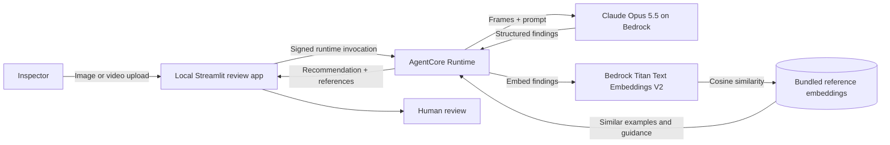

# LineSight Quality Inspection

LineSight is a demo of AI-assisted visual quality inspection for manufacturing, built on Amazon Bedrock. Upload a photo or a short video clip of a manufactured part, and LineSight returns a PASS / REVIEW / FAIL recommendation, the visible defects with their severity and location, and the most relevant entries from a reference library of defect examples and inspection guidance — all with zero idle infrastructure cost.

The model's decision is a recommendation. A human inspector makes the final disposition. Reference records in `data/defect-references.json` are synthetic demo examples; replace them with approved quality procedures and labeled examples before relying on the results.

## How it works

- **Claude Opus 5.5 on Amazon Bedrock** (called through the official Anthropic SDK) inspects the image and reports findings. The request uses structured outputs with a JSON schema, so the response always matches the expected shape — no free-text parsing.
- **Titan Text Embeddings V2** converts the model's defect description into a vector, which is ranked by cosine similarity against precomputed embeddings of the reference library. The library is small, so retrieval runs in-process — no vector database required. (gotta cut back on cost where I can)
- **Amazon Bedrock AgentCore Runtime** hosts the inspection workflow as a serverless agent, billed only while a request runs. (again saving money)
- **A local Streamlit app** is the inspector's review screen: it resizes uploads, invokes the runtime, and presents the recommendation, findings, similar references, and (for video) the sampled frames.



### Video clips

Short video clips are supported by frame sampling: the review app extracts evenly spaced frames from an uploaded clip (2-12, selectable), resizes them, and sends them to the runtime as one batch. The runtime labels each frame and asks Claude to report each distinct defect once with the frame number where it is most clearly visible, using agreement across frames to separate real defects from glare or reflections. The runtime accepts up to 20 frames totaling 5 MB per request; cost scales with the number of frames, not clip length.

## Cost

There is no always-on infrastructure in this stack:

- **AgentCore Runtime** bills per consumed CPU/memory second while a request runs, with no idle charge.
- **Bedrock model invocations** are pay-per-request. A single-image inspection with Claude Opus 5.5 ($4/M input, $20/M output tokens on the first-party API; see [Bedrock pricing](https://aws.amazon.com/bedrock/pricing/) for Bedrock rates) costs on the order of a cent; a Titan embedding call is a fraction of that. Video inspections cost roughly one image inspection per sampled frame, so an 8-frame clip is still only a few cents.

To cut per-inspection cost further, set `VISION_MODEL_ID` to `anthropic.claude-haiku-5-5` (about 40x cheaper per token); the IAM policy already permits any Anthropic Claude model, so this needs only an environment-variable change and a redeploy of the runtime config.

### What a production system would add

The near-zero idle cost is a property of demo-scale choices, not of the architecture in general. A production deployment would reintroduce always-on infrastructure and its baseline cost:

- **A managed vector store.** In-process cosine similarity works because the reference library is a few dozen records bundled with the runtime. A real defect knowledge base — thousands of records, updated by quality engineers, queried with filters — needs a service like OpenSearch Serverless, which bills for minimum capacity continuously (roughly $175+/month even when idle), or an alternative such as Aurora PostgreSQL with pgvector or Amazon S3 Vectors.
- **A hosted review application** behind authentication (for example ECS/App Runner plus a load balancer and an identity provider) instead of a Streamlit app on an inspector's workstation.
- **Operational baseline:** VPC networking instead of public endpoints, image and audit-trail storage for traceability, monitoring and alarming, and model spend that scales with line throughput rather than demo clicks.

None of that changes the inspection workflow itself — the demo and a production system share the same Bedrock calls — but the always-on components, not the per-request AI calls, would dominate the bill at low volume.

## Prerequisites

- Node.js 20 or later, npm, Python 3.10 or later, and AWS CDK.
- An AWS profile with Bedrock, AgentCore, CloudFormation, S3, and IAM permissions.
- Region `us-west-2`; model invocation access for Anthropic Claude and Titan Text Embeddings V2 enabled in the Bedrock console.
- The repository Python environment uses Python 3.13 to package Linux ARM64 wheels for AgentCore Runtime.

Use any local AWS credential profile with access to the target account; it is not used in AWS resource names.

## Configure local development

```bash
cp .env.example .env
python3.13 -m venv .venv
source .venv/bin/activate
pip install -r requirements.txt
npm install
```

`.env` contains only non-secret settings. Do not place AWS access keys or session tokens there. Boto3 reads the local AWS profile configured in `~/.aws/credentials`; select it in the shell with `export AWS_PROFILE=<your-profile>` or uncomment `AWS_PROFILE` in `.env`.

## Precompute reference embeddings

Before packaging the runtime, embed the reference records once (requires Bedrock access for Titan):

```bash
source .venv/bin/activate
python scripts/embed_references.py
```

This writes `runtime/reference_embeddings.json`, which is bundled into the AgentCore CodeZip. Rerun it whenever `data/defect-references.json` changes.

## Synthesize and deploy

```bash
export AWS_PROFILE=<your-profile>
export AWS_DEFAULT_REGION=us-west-2
npm run build
npm run synth
npx cdk deploy
```

If CDK reports that the environment is not bootstrapped, bootstrap the account and region once, then deploy again:

```bash
npx cdk bootstrap aws://<account-id>/us-west-2
npx cdk deploy
```

Accounts with a managed CDK bootstrap under a custom qualifier can pass it at deploy time with `npx cdk deploy -c qualifier=<qualifier>` (or set `CDK_QUALIFIER`), matching the `--qualifier` used at bootstrap.

The stack creates an AgentCore Runtime with a five-minute idle timeout and a least-scope model invocation policy (Anthropic Claude models plus the Titan embedding model). No images are persisted by the demo. `npm run synth` and `npm run deploy` package Python 3.13 Linux ARM64 dependencies into the AgentCore CodeZip asset before invoking CDK.

If the runtime logs an access-denied error from Bedrock, confirm model access is enabled in the Bedrock console for the region, and that the model you configured resolves to one of the ARNs in the stack's `InvokeInspectionAndEmbeddingModels` policy statement.

## Run the review app

Copy the `AgentRuntimeArn` output to `.env` as `AGENT_RUNTIME_ARN`, then run:

```bash
source .venv/bin/activate
streamlit run web/app.py
```

Upload an image or a short video clip (MP4, MOV, M4V, AVI, or WebM) and select **Inspect image** or **Inspect video**. For video, choose how many frames to sample; the app shows the sampled frames alongside the result, and each finding names the frame where it is most visible. The app resizes everything before sending it to AgentCore, shows the recommendation with the model's confidence and latency, and lists the closest reference records with their similarity scores. Low-confidence or ambiguous results should go to manual review.

## Extending the demo

- **Cheaper inspections at volume:** switch `VISION_MODEL_ID` to `anthropic.claude-haiku-5-5` and compare quality on your own parts; for a bounded task with a fixed schema, the small model is often sufficient.
- **Photo-based reference matching:** the current design matches on text (defect description to guidance text). With a library of labeled defect photos, an image embedding model such as Amazon Nova Multimodal Embeddings could match the uploaded part image against reference images directly.
- **Real reference data:** replace the synthetic records in `data/defect-references.json` with your plant's approved inspection criteria, rerun `scripts/embed_references.py`, and redeploy.

## Clean up

```bash
npx cdk destroy
```

This removes the stack-managed AgentCore resources. CDK bootstrap resources are shared by other stacks in the account; remove them only if nothing else uses them.
